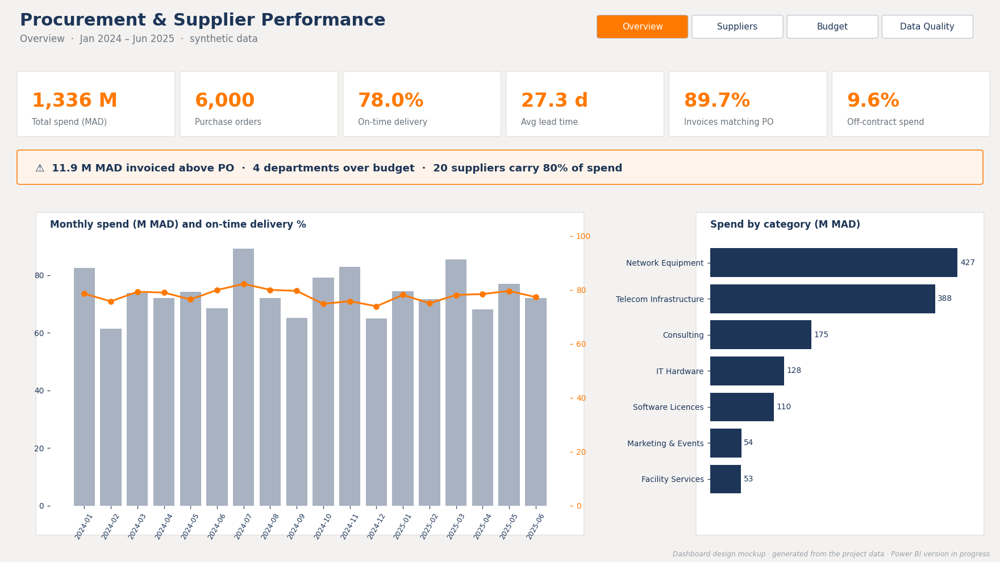
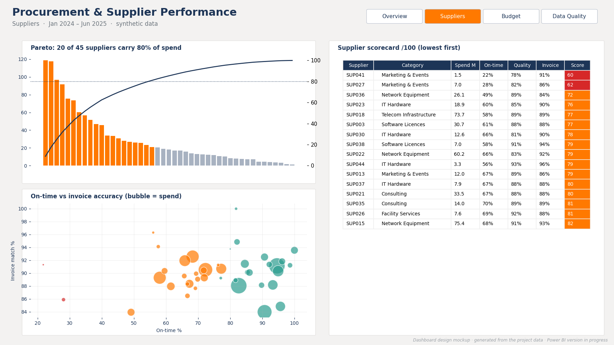
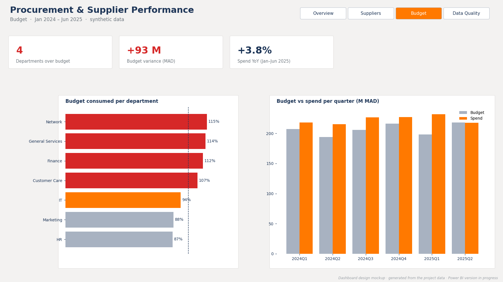
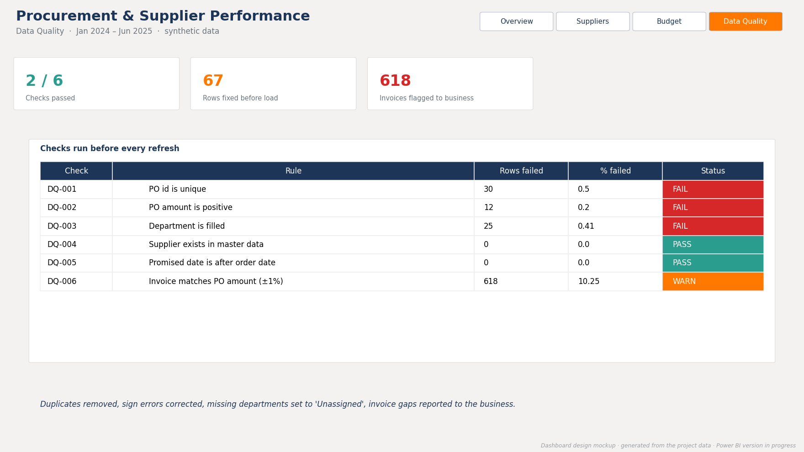

# Procurement & Supplier Performance Analytics
   

> 🇬🇧 English below · 🇫🇷 Version française plus bas

## Why I built this

During my time as a Data Analyst in a telecom procurement team, I built more than 15 Power BI dashboards to follow purchasing KPIs and supplier performance. The most useful thing I did there wasn't a chart: it was automating a monthly report that used to take **two days** of copy-pasting in Excel, down to **30 minutes**.

What I learned is that buyers and managers don't need more numbers. They need to know, every month, **which suppliers to call, which budgets are slipping, and whether they can trust the data in front of them.**

This project rebuilds that workflow from scratch, end to end, on a synthetic dataset I designed to look like the real thing: raw extracts → quality checks → SQL warehouse → KPIs → a **Power BI dashboard**. Python does the data work and the testing; Power BI is where people read the story. The data pipeline runs in **under one second**.

> **Data note:** all data is synthetic, generated by `src/generate_data.py`. No company data is used. Real-world problems (duplicate POs, negative amounts, missing departments, invoices above the PO amount) are injected on purpose.

## What it does

```
raw CSVs ──► Data quality ──► Clean & ──► SQLite ──► SQL reference ──► Power BI export ──► Power BI dashboard
(ERP-like    DQ-001→006       transform   warehouse   KPIs              star schema CSVs     4 pages, 25+ DAX measures
 extracts)   PASS/WARN/FAIL                                                                  validated against SQL
```

| Step | Tool | What happens |
|---|---|---|
| Generate | Python | 45 suppliers, 6,000 purchase orders (Jan 2024–Jun 2025), quarterly budgets for 7 departments |
| Check | Python | 6 data quality rules with IDs, status PASS / WARN / FAIL, run **before** any KPI |
| Clean & load | Python + SQLite | Remove duplicates, fix sign errors, compute delays and invoice gaps, load a star schema |
| Reference KPIs | SQL | 6 named queries: overview, supplier scorecard, spend by category, trend, budget, off-contract spend |
| Export | Python | 6 tables for Power BI: `fact_purchase_order`, `fact_budget`, `dim_supplier`, `dim_department`, `dim_date`, `dq_results` |
| Visualise | **Power BI** | Power Query (typed, parameterised), star schema model, DAX measures, custom theme, 4 report pages |

## The Power BI dashboard

| Page | What it answers |
|---|---|
| **Overview** | How much are we spending, are suppliers delivering on time, and what needs attention this month? (dynamic DAX headline) |
| **Suppliers** | Pareto of spend, scorecard /100 with conditional formatting, on-time vs invoice accuracy scatter: which suppliers to call first |
| **Budget** | Budget consumed per department and per quarter, year-over-year spend |
| **Data Quality** | Results of the 6 checks run before every refresh, so users know they can trust the numbers |

> The images below are the **dashboard design**, generated in Python from the project data (`powerbi/maquette/make_mockup.py`). The Power BI build follows this design and is in progress; screenshots will replace them in `reports/screenshots/`.






DAX highlights (`powerbi/measures.dax`): time intelligence (`SAMEPERIODLASTYEAR`, `TOTALYTD`), a weighted supplier score, a Pareto cumulative % with `ALLSELECTED`, colour measures for conditional formatting, and a dynamic text headline.

Everything needed to rebuild the dashboard is in `powerbi/`: `power_query.m`, `measures.dax`, `procurement_theme.json` and a step-by-step `POWERBI_GUIDE.md`.

## Key findings

| KPI | Value |
|---|---|
| Total spend | **1,336 M MAD** over 6,000 POs |
| On-time delivery | **78.0%** |
| Average lead time | **27.3 days** |
| Invoices matching the PO (±1%) | **89.7%**, with **11.9 M MAD** invoiced above the PO amount |
| Spend with suppliers without a framework contract | **9.6%** |

- **Supplier scorecard**: two marketing suppliers deliver on time less than 30% of the time: they're the first calls to make.
- **Concentration**: 20 of 45 suppliers carry 80% of spend.
- **Budget**: 4 departments are over budget, Network the most (115%).

## Dashboard validation

A dashboard is only useful if its numbers are right. Every DAX measure is checked, with no filter applied, against the value computed independently in SQL:

| ID | Measure | Expected (SQL) | Power BI |
|---|---|---|---|
| TC-BI-01 | Total Spend | 1,335.9 M MAD | ☐ |
| TC-BI-02 | PO Count | 6,000 | ☐ |
| TC-BI-03 | On-Time % | 78.0% | ☐ |
| TC-BI-04 | Avg Lead Time | 27.3 days | ☐ |
| TC-BI-05 | Invoice Match % | 89.7% | ☐ |
| TC-BI-06 | Overbilled Amount | 11.87 M MAD | ☐ |
| TC-BI-07 | Off-Contract Spend % | 9.6% | ☐ |
| TC-BI-08 | Departments Over Budget | 4 | ☐ |
| TC-BI-09 | Open POs | 150 | ☐ |
| TC-BI-10 | Spend YoY % (Jan–Jun 2025) | +3.8% | ☐ |
| TC-BI-11 | Suppliers for 80% of Spend | 20 | ☐ |

## Data quality first

A KPI built on bad data is worse than no KPI. Every run starts with these checks, logged like test cases:

| ID | Rule | Rows caught | Status |
|---|---|---|---|
| DQ-001 | PO id is unique | 30 | FAIL → deduplicated |
| DQ-002 | PO amount is positive | 12 | FAIL → sign fixed |
| DQ-003 | Department is filled | 25 | FAIL → "Unassigned" |
| DQ-004 | Supplier exists in master data | 0 | PASS |
| DQ-005 | Promised date after order date | 0 | PASS |
| DQ-006 | Invoice matches PO (±1%) | 618 | WARN → reported to the business |

## Tests

18 automated tests with `pytest`:
- **TC-DQ-000 → 007**: each quality rule catches its defect, and clean data passes.
- **TC-ETL-001 → 006**: no duplicates, no negative amounts, **total spend reconciles with the source**, row counts match in the warehouse.
- **TC-KPI-001 → 003**: SQL results match the same KPI computed in pandas, scores stay between 0 and 100.
- **TC-BI-001**: the Power BI export keeps the same total spend, and every foreign key exists in its dimension.

## Running it

```bash
pip install -r requirements.txt
cd src
python generate_data.py    # synthetic raw data
python run_pipeline.py     # checks → warehouse → SQL KPIs → powerbi/data/*.csv
cd .. && pytest tests/ -v
```

Then open Power BI Desktop and follow `powerbi/POWERBI_GUIDE.md` .

## Structure

```
src/          generate_data.py · quality.py · etl.py · kpis.py · export_powerbi.py · run_pipeline.py
sql/          kpis.sql (named reference queries)
tests/        test_quality.py · test_pipeline.py
data/raw/     synthetic source CSVs
powerbi/      power_query.m · measures.dax · procurement_theme.json · POWERBI_GUIDE.md · maquette/
powerbi/data/ star-schema CSVs loaded by Power BI
reports/      procurement_dashboard.pdf · screenshots/
```

---

## 🇫🇷 Version française

**Pourquoi ce projet.** Comme Data Analyst dans une équipe achats télécom, j'ai créé plus de 15 dashboards Power BI pour suivre les KPI achats et la performance fournisseurs. Ce qui a eu le plus d'impact n'était pas un graphique : c'était l'automatisation d'un reporting mensuel qui prenait **2 jours** de copier-coller sous Excel, ramené à **30 minutes**. J'en ai retenu une chose : les managers n'ont pas besoin de plus de chiffres, ils ont besoin de savoir chaque mois **quels fournisseurs appeler, quels budgets dérapent, et s'ils peuvent faire confiance aux données.**

Ce projet reconstruit ce workflow de bout en bout sur des données **synthétiques** que j'ai conçues pour ressembler au réel : Python et SQL pour la donnée et les tests, **Power BI pour la restitution**.

**Ce qu'il apporte**
- **6 contrôles qualité** identifiés (DQ-001 → 006) exécutés avant tout calcul : doublons, montants négatifs, départements manquants, écarts facture/commande.
- **Modèle en étoile** (2 faits, 4 dimensions) et **KPI de référence en SQL**.
- **Dashboard Power BI de 4 pages** : vue d'ensemble avec titre dynamique, scorecard fournisseurs /100 et Pareto, suivi budgétaire avec comparaison N-1, page qualité des données.
- **Power Query** typé et paramétré, **25+ mesures DAX** (intelligence temporelle, Pareto avec `ALLSELECTED`, mise en forme conditionnelle), thème personnalisé.
- **Validation du dashboard** : chaque mesure DAX est comparée à la valeur SQL (TC-BI-01 → 10).
- **18 tests automatisés** (pytest), dont la réconciliation des montants entre la source, l'entrepôt et l'export Power BI.

**Stack** : Power BI (DAX, Power Query), Python, pandas, SQL (SQLite), pytest.
